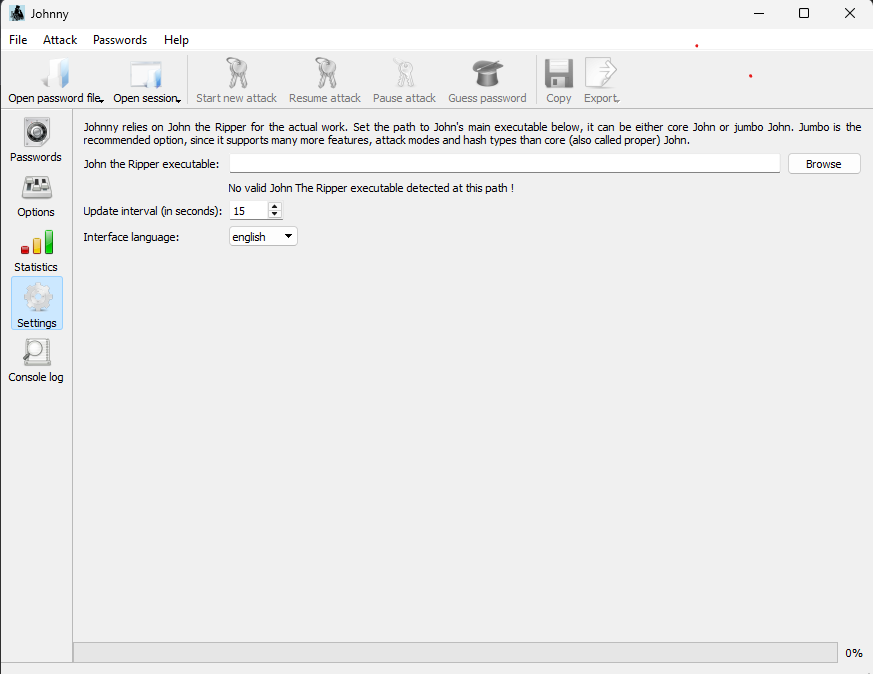

# Networkwalks-B084-Week3-Password-Cracking
Week 3 cybersecurity practical: Password recovery using John the Ripper, Johnny GUI, and Networkwalks online password-cracking tools.

# 🔐 Password Cracking & Recovery – Week 3

### Cybersecurity & Ethical Hacking | Networkwalks Cohort B084

**Week 3 | Project Module 1 & Module 2**

---

## 📌 Project Overview

As part of the Cybersecurity & Ethical Hacking programme at Networkwalks, this project explores password cracking and recovery techniques using two different approaches.

The practical exercises demonstrate how security professionals can assess password strength by recovering passwords from protected files in a controlled learning environment.

The project consists of two modules:

- **Module 1: Password Cracking with John the Ripper (JTR) and Johnny GUI**
- **Module 2: Password Cracking with Networkwalks Online Tools**

Both exercises involved recovering the password of a supplied password-protected PDF file.

## 🎯 Project Objectives

- Understand the fundamentals of password cracking and password recovery.
- Understand the role of hashes in password verification and recovery.
- Install and configure John the Ripper and Johnny on Windows.
- Extract password hashes from protected PDF documents.
- Use John the Ripper through its graphical interface, Johnny.
- Explore browser-based password recovery tools provided by Networkwalks.
- Recover the password of the supplied PDF file.
- Understand the importance of strong passwords and secure document protection.

## 🖥️ Environment & Tools

| Component | Details |
|---|---|
| Operating System | Windows 11 |
| Password Cracking Tool | John the Ripper (JTR) |
| Graphical Interface | Johnny GUI |
| Module 1 Hash Extraction | Online PDF Hash Extractor |
| Module 2 Hash Extraction | Networkwalks Hash Calculator |
| Module 2 Password Recovery | Networkwalks Password Cracker |
| Target File | My Locked PDF1.pdf |
| Practical Environment | Controlled educational lab |

## 🔧 Module 1: Password Cracking with John the Ripper (JTR)

### 1.1 Introduction

John the Ripper is a password security auditing and password recovery tool capable of working with different password hash formats.

Johnny is its graphical user interface (GUI), providing a point-and-click approach to working with John the Ripper.

In this exercise, I used John the Ripper and Johnny to recover the password of a supplied protected PDF document.

### 1.2 Installation and Configuration

The practical involved:

1. Downloading John the Ripper from the official Openwall website.
2. Downloading and installing Johnny GUI.
3. Opening Johnny and navigating to its settings.
4. Locating and configuring the `john.exe` executable.
5. Confirming that Johnny could detect the John the Ripper executable.

**Official resources:**

- [John the Ripper – Openwall](https://www.openwall.com/john/)
- [Johnny GUI – Openwall](https://openwall.info/wiki/john/johnny)

### 1.3 PDF Hash Extraction

The supplied encrypted PDF file, `My Locked PDF1.pdf`, was used for the exercise.

The PDF hash extraction process involved:

1. Uploading the supplied PDF to the PDF Hash Extractor.
2. Extracting the password hash.
3. Copying the complete hash value.
4. Saving the extracted hash in a text file named `hash1.txt`.

The extracted hash was then prepared for use with John the Ripper.

### 1.4 Password Recovery Using Johnny

After preparing the hash file:

1. Opened Johnny.
2. Selected **Open Password File**.
3. Browsed to and loaded `hash1.txt`.
4. Selected **Start New Attack**.
5. Allowed the tool to process the hash.
6. Observed the recovered password in Johnny.

The recovered password was then used to open the supplied PDF document successfully.

### 1.5 Evidence – Module 1

*Screenshots documenting the installation, configuration, hash extraction and password recovery process.*

**Johnny Installation and Configuration**

**John Executable Configuration**

**PDF Hash Extraction**

**Hash File Preparation**

**Loading the Hash into Johnny**

**Password Recovery Process**

**Recovered Password**

---

## 🌐 Module 2: Password Cracking with Networkwalks Tools

### 2.1 Introduction

The second exercise introduced browser-based password recovery using two online tools provided by Networkwalks:

- **Hash Calculator:** Extracts the password hash from a protected PDF file.
- **Password Cracker:** Attempts to recover the original password using the extracted hash.

Unlike the first exercise, this approach did not require installing John the Ripper or Johnny.

### 2.2 Tools Used

| Tool | Purpose |
|---|---|
| Networkwalks Hash Calculator | Extracting the PDF password hash |
| Networkwalks Password Cracker | Recovering the password from the extracted hash |
| Web Browser | Accessing the online tools |

**Tool resources:**

- [Networkwalks Project Instructions](https://networkwalks.com/project-task-lab-password-cracking-with-networkwalks-tools/)
- [Networkwalks Hash Calculator](https://networkwalks.com/hash-calculator/)
- [Networkwalks Password Cracker](https://networkwalks.com/password-cracker/)

### 2.3 Practical Procedure

The exercise followed these steps:

1. Downloaded the supplied encrypted PDF file, `My Locked PDF1.pdf`.
2. Opened the Networkwalks Hash Calculator.
3. Uploaded the protected PDF document.
4. Extracted and copied the generated hash value.
5. Opened the Networkwalks Password Cracker.
6. Pasted the extracted hash into the password recovery tool.
7. Started the cracking process and waited for the result.
8. Obtained the recovered password.
9. Opened the original PDF using the recovered password.

### 2.4 Result

The password recovery process was successful. The recovered password was used to unlock and access the supplied PDF document.

### 2.5 Evidence – Module 2

*Screenshots documenting the browser-based hash extraction and password recovery process.*

**Protected PDF Document**

**Networkwalks Hash Calculator**

**Extracted PDF Hash**

**Networkwalks Password Cracker**

**Password Recovery Result**

**Successfully Unlocked PDF**

---

## 💡 Key Learnings

Through these practical exercises, I gained experience and a better understanding of:

1. **Password Hashing:** Understanding how passwords can be represented by hashes and why password hashes are important in authentication systems.
2. **Password Recovery:** Learning how password-cracking tools attempt to recover passwords from extracted hashes.
3. **John the Ripper:** Gaining practical exposure to a widely used password auditing and recovery tool.
4. **Johnny GUI:** Learning how to configure and operate John the Ripper through a graphical interface.
5. **Hash Extraction:** Understanding how password hashes can be extracted from protected PDF documents for security testing.
6. **Browser-Based Security Tools:** Exploring how online tools can simplify password recovery exercises without requiring local software installation.
7. **Password Security Awareness:** Understanding why short, predictable and commonly used passwords are vulnerable to password-cracking attempts.

## 🔐 Security Lessons & Recommendations

The exercises reinforced the importance of strong password practices.

Recommended security measures include:

- Use long, unique passwords or passphrases.
- Avoid common words, predictable patterns and reused passwords.
- Use a reputable password manager.
- Enable multi-factor authentication wherever possible.
- Apply appropriate encryption and access controls to sensitive documents.
- Never upload confidential documents or personal files to third-party hash extraction or password recovery websites without understanding their privacy and security implications.

## ⚖️ Ethical Considerations

All password recovery activities documented in this repository were performed as part of an authorised educational exercise using the supplied lab material.

John the Ripper and other password recovery tools should only be used on files, systems and password hashes that you own or have explicit permission to test.

This project is intended for cybersecurity education, password security awareness and ethical security testing.

## 🏁 Conclusion

Week 3 provided practical exposure to password recovery using both locally installed software and browser-based tools.

By working with John the Ripper, Johnny GUI and Networkwalks online tools, I gained a better understanding of how password hashes are extracted and how password recovery tools attempt to identify the original password.

Most importantly, the exercises demonstrated why strong, unique passwords and appropriate document protection mechanisms are essential for information security.

This practical experience adds to my growing understanding of cybersecurity tools and their application in controlled security assessments.

## 🙏 Acknowledgements

Special appreciation to **Waqas Karim (CCIE)** and the **Networkwalks team** for their instruction, practical demonstrations and continued support throughout the Cybersecurity & Ethical Hacking programme.

**Programme:** Networkwalks – Cohort B084  
**Project:** Week 3 – Password Cracking  
**Modules:** Module 1 and Module 2

---

## 👤 Author

**Tanaka Mushedhe**  
Cybersecurity Learner | Networkwalks Cohort B084

[GitHub Profile](https://github.com/Tanmuch7583)

[LinkedIn Profile](YOUR_LINKEDIN_URL)

---

*Learning. Practising. Securing. 🚀*
